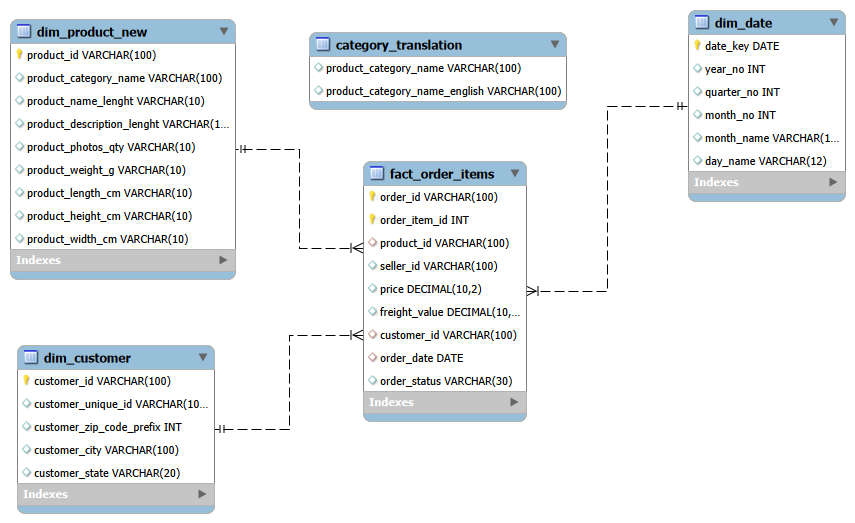
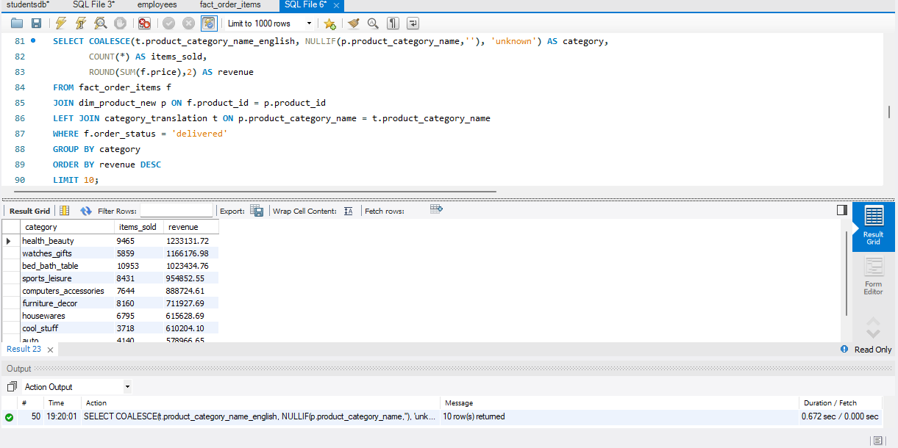

# E-Commerce Data Warehouse in MySQL

I took the order data of a Brazilian online marketplace (Olist) and rebuilt it as a small data warehouse in MySQL: one fact table in the middle and three dimension tables around it. Then I used it to answer six business questions with SQL.

---

## The problem

The raw Olist files are separate tables. The order items file has the price and the product, but no customer and no date, and the category names are in Portuguese. Every question needs several joins.

So I put the data in one clean shape, checked that nothing was broken, and then asked the questions.

## What I built

A star schema. The fact table has one row per item sold. The dimension tables describe the product, the customer and the date.

| Table | What it holds |
|---|---|
| `fact_order_items` | one row per item sold (112,650 rows): price, freight, product, seller, customer, date, status |
| `dim_product_new` | product and its category name |
| `dim_customer` | customer city and state |
| `dim_date` | one row per day, Sep 2016 to Dec 2018 (852 rows) |
| `category_translation` | Portuguese to English category names (lookup table) |

## How I did it

1. Loaded the Olist CSV files with the Table Data Import Wizard and made a backup of the fact table.
2. The order items had no customer or date, so I loaded the orders file into a staging table and copied the customer, date and status into the fact table with one UPDATE (112,650 rows).
3. Built `dim_date` with a recursive query, so every day has a row.
4. Added the foreign keys last, once the data was clean.
5. Ran a validation query, then wrote the six queries.

## Checking the data

| Check | Result |
|---|---|
| Fact rows with no matching product | 🟩 0 |
| Fact rows with no matching customer | 🟩 0 |
| Fact rows with no matching date | 🟩 0 |
| Fact rows with a missing customer, date or status | 🟩 0 |

## What the data says

Revenue is the sum of the item price for orders with status `delivered`. Freight is not included. Amounts are in Brazilian reais (R$).

| Delivered orders | Items sold | Revenue | Average order value | Period |
|---|---|---|---|---|
| 96,478 | 110,197 | R$ 13,221,498 | R$ 137.04 | Sep 2016 to Aug 2018 |

**Top categories (Q1)**

| Category | Items sold | Revenue (R$) |
|---|---|---|
| health_beauty | 9,465 | 1,233,132 |
| watches_gifts | 5,859 | 1,166,177 |
| bed_bath_table | 10,953 | 1,023,435 |

The top 5 categories bring in about 40% of the revenue. `bed_bath_table` sells the most items but is third in revenue.

**Top states (Q3)**

| State | Orders | Revenue (R$) |
|---|---|---|
| SP | 40,501 | 5,067,633 |
| RJ | 12,350 | 1,759,651 |
| MG | 11,354 | 1,552,482 |

São Paulo alone is about 38% of the revenue. The top three states together are about 63%.

**Order status (Q6)**

| Status | Orders | Share |
|---|---|---|
| 🟩 delivered | 96,478 | 97.8% |
| 🟧 shipped | 1,106 | 1.1% |
| 🟥 canceled | 461 | 0.5% |
| 🟧 other (invoiced, processing, approved) | 615 | 0.6% |
| 🟥 unavailable | 6 | 0.0% |

**Also found**

- **Freight (Q5):** it is the biggest share of the price for `christmas_supplies` (36.5%), `signaling_and_security` (30.4%) and `electronics` (29.5%). These are mostly low-priced items.
- **Sellers (Q4):** the top two sellers earn almost the same (R$ 227 thousand and R$ 218 thousand), but the second one does it with only 400 items against 1,148.
- **Months (Q2):** 2016 has very few orders, so I do not read any trend into it.

## What this project does not do

- There is no seller table, so Q4 shows seller IDs only.
- `dim_product` is an older table I did not use.
- Product weight and size are stored as text and are not used.
- Revenue is item price only. It does not subtract returns or discounts.
- Queries ran in 0.2 to 1.1 seconds on about 112,000 rows. I did not test anything bigger.
- There is no dashboard on top of it.

## Files

| File | What it is |
|---|---|
| `01_schema.sql` | Creates the 5 empty tables with their keys |
| `02_transform.sql` | The steps to load, join and clean the data |
| `03_validation.sql` | The check for missing or unmatched rows |
| `04_queries.sql` | The headline numbers and the six queries |
| `schema.png` | The schema diagram |
| `q1_top_categories.png` | Screenshot of Q1 with its result and run time |
| `REPORT.pdf` | A short written report |

## Data

[Brazilian E-Commerce Public Dataset by Olist](https://www.kaggle.com/datasets/olistbr/brazilian-ecommerce) on Kaggle (CC BY-NC-SA 4.0). I have not put the CSV files in this repo, so please download them from Kaggle.

## Tools

MySQL 8.0, MySQL Workbench.

## About me

Varshini K
[LinkedIn](https://www.linkedin.com/in/varshini-k-4b27a0353) · varshinikumar407@gmail.com
